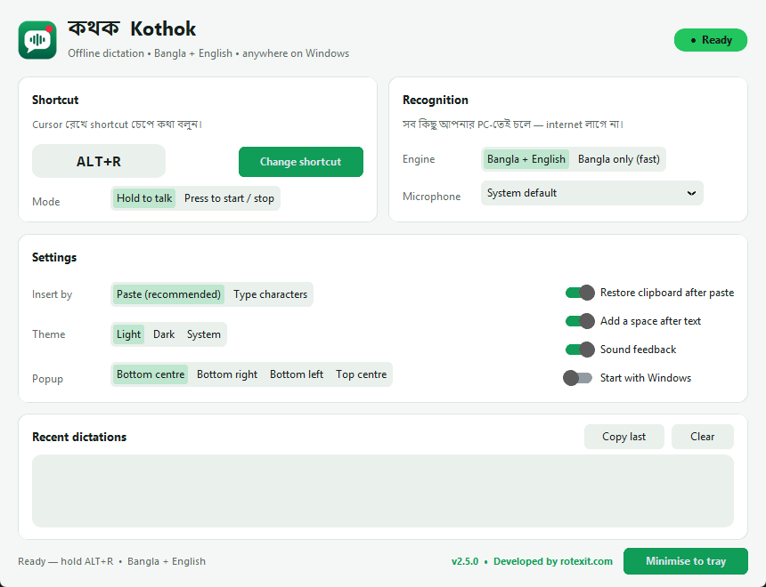

<p align="center">
  
</p>

<h1 align="center">কথক · Kothok</h1>

<p align="center">
  <b>Windows-এর জন্য অফলাইন বাংলা + English ভয়েস টাইপিং</b><br>
  যেকোনো অ্যাপে শর্টকাট চেপে কথা বলুন — লেখা নিজে থেকেই বসে যাবে।
</p>

<p align="center">
  <a href="https://github.com/itrabbi24/kothok/releases/latest"></a>
  <a href="LICENSE"></a>
  
</p>

<p align="center">
  <a href="https://github.com/itrabbi24/kothok/releases/latest/download/Kothok-portable.zip"><b>⬇ ডাউনলোড করুন (Kothok-portable.zip)</b></a>
</p>

<p align="center"></p>

---

## কথক কী?

কথক একটা ছোট্ট Windows অ্যাপ, যেটা system tray-তে বসে থাকে। Word, Chrome, WhatsApp, Facebook, VS Code — যেখানেই কার্সর থাকুক, শর্টকাট (ডিফল্ট **Alt+R**) চেপে ধরে কথা বলুন, ছেড়ে দিন। আপনার কথা লেখা হয়ে ঠিক সেখানেই বসে যাবে।

> "আমি আজকে **I want to make a coffee**" — বাংলা অংশ বাংলায়, English অংশ English-এ লেখা হবে।

### মূল বৈশিষ্ট্য

- **১০০% অফলাইন** — ইন্টারনেট, ক্লাউড বা কোনো API লাগে না। আপনার ভয়েস কখনো আপনার পিসির বাইরে যায় না।
- **ইনস্টল লাগে না (portable)** — zip খুলুন, `Kothok.exe` চালান। পেনড্রাইভে করেও নেওয়া যায়।
- **বাংলা + English মিশিয়ে** বলা যায়, অথবা শুধু বাংলার জন্য দ্রুত মোড।
- **Hold-to-talk** অথবা **Press to start/stop** — দুই রকম মোড।
- **নিজের মতো শর্টকাট** সেট করা যায়।
- **Silent auto update** — GitHub-এ নতুন ভার্সন এলে অ্যাপ নিজে থেকে চুপচাপ আপডেট হয়ে যায় (নিচে বিস্তারিত)।
- Windows-এর সাথে চালু হওয়ার অপশন, শব্দ দিয়ে ফিডব্যাক, শেষ লেখা কপি করার অপশন।

## ব্যবহার করার নিয়ম

1. [Releases](https://github.com/itrabbi24/kothok/releases/latest) পেজ থেকে **`Kothok-portable.zip`** ডাউনলোড করুন (~৩৫০ MB, ভয়েস মডেলসহ)।
2. zip-টা যেকোনো জায়গায় extract করুন, যেমন `D:\Kothok`।
   > Program Files-এ না রাখাই ভালো — তাহলে auto update কাজ করবে না।
3. `Kothok.exe` চালান। প্রথমবার সেটিংস উইন্ডো খুলবে।
4. উইন্ডো বন্ধ করলে অ্যাপ tray-তে চলে যায় (ঘড়ির পাশে সবুজ টাইলের উপর লাল সূর্য আর মাইক)।
5. যেকোনো লেখার জায়গায় ক্লিক করুন → **Alt+R চেপে ধরে কথা বলুন → ছেড়ে দিন।**

> Windows SmartScreen "Windows protected your PC" দেখালে **More info → Run anyway** চাপুন। (exe-টা code-signed না, তাই এই সতর্কবার্তা আসে।)

### Tray icon-এর মানে

| আইকন | অবস্থা |
|---|---|
| লাল সূর্য | প্রস্তুত (Ready) |
| সাদা বৃত্তসহ লাল | শুনছে (Listening) |
| হলুদ | লিখছে (Transcribing) |
| ধূসর | সমস্যা — সেটিংস/লগ দেখুন |

Tray icon-এ right-click করলে পাবেন: dictation চালু/বন্ধ, শেষ লেখা কপি, engine, mode, শর্টকাট pause, sound, Start with Windows, Auto update, log ফাইল, Exit।

### সেটিংস

| সেটিং | কাজ |
|---|---|
| **Shortcut** | "Change shortcut" চেপে নতুন কী-কম্বিনেশন চাপুন (Esc = বাতিল) |
| **Mode** | Hold to talk (চেপে ধরে বলা) / Press to start-stop (একবার চাপলে শুরু, আবার চাপলে শেষ) |
| **Engine** | *Bangla + English* (ডিফল্ট) / *Bangla only (fast)* |
| **Microphone** | কোন মাইক ব্যবহার হবে |
| **Insert by** | *Paste* (দ্রুত, ক্লিপবোর্ড আগের মতো ফিরিয়ে দেয়) / *Type characters* (যেখানে paste চলে না) |

সেটিংস `Kothok.exe`-এর পাশেই `config.json`-এ সেভ থাকে, তাই ফোল্ডার কপি করলে সেটিংসও সাথে যায়।

### টিপস

- এক বাক্যের মাঝে English শব্দ থাকলে, English অংশের আগে-পরে একটু থামুন — তাহলে সেটা English অক্ষরে লেখা হবে।
- শান্ত জায়গায় আর মাইক মুখের কাছে রাখলে ফল সবচেয়ে ভালো আসে।
- কোনো অ্যাপে paste কাজ না করলে Settings → Insert by → **Type characters** দিন।

### সিস্টেম রিকোয়ারমেন্ট

Windows 10/11 (64-bit) · ৪ GB+ RAM (৮ GB হলে ভালো) · মাইক্রোফোন · প্রায় ৪০০ MB জায়গা

## অটো আপডেট কীভাবে কাজ করে

- অ্যাপ চালু হওয়ার কিছুক্ষণ পর, তারপর প্রতি ৬ ঘণ্টায় একবার GitHub-এ সর্বশেষ release চেক করে।
- নতুন ভার্সন পেলে শুধু অ্যাপের অংশটুকু (`Kothok-update.zip`, ভয়েস মডেল ছাড়া) ব্যাকগ্রাউন্ডে নামায়।
- আপনি অন্তত ২ মিনিট dictation না করলে তবেই অ্যাপ নিজেকে বন্ধ করে, নতুন ফাইল বসায় আর আবার চালু হয় — কয়েক সেকেন্ড লাগে।
- আপনার `config.json` আর `models` ফোল্ডারে কখনো হাত দেয় না।
- এই চেকটাই অ্যাপের একমাত্র ইন্টারনেট ব্যবহার। ভয়েস বা লেখা কোথাও পাঠানো হয় না। চাইলে tray মেনু থেকে **Auto update** বন্ধ রাখতে পারেন।
- ফোল্ডারে লেখার অনুমতি না থাকলে (যেমন Program Files) auto update নিজে থেকেই বন্ধ থাকে।

## Developer-দের জন্য

Python 3.12+ লাগবে।

```powershell
.\setup.ps1             # .venv বানায় আর প্যাকেজ ইনস্টল করে
.\download-model.ps1    # ভয়েস মডেল নামায় (বাংলা ~90 MB + ভাষা চেনার মডেল ~160 MB)
.\run.ps1               # সোর্স থেকে চালায়
.\build-portable.ps1    # dist\Kothok\Kothok.exe, dist\Kothok-portable.zip, dist\Kothok-update.zip
```

### প্রজেক্টের গঠন

```
app.py               পুরো অ্যাপ: কীবোর্ড হুক, অডিও, স্পিচ ইঞ্জিন, paste/type, overlay, tray, সেটিংস UI, আপডেটার
Kothok.spec          PyInstaller বিল্ড কনফিগ
version_info.txt     exe-এর ভার্সন তথ্য
build-portable.ps1   portable বিল্ড + zip
download-model.ps1   মডেল ডাউনলোড
assets/              লোগো (SVG/PNG/ICO), tools/make_assets.py দিয়ে বানানো
legacy/              পুরোনো v1 কোড, রেফারেন্সের জন্য রাখা
```

### কীভাবে কাজ করে

- **শর্টকাট:** Windows low-level keyboard hook (`WH_KEYBOARD_LL`)। শর্টকাটটা অন্য অ্যাপে পৌঁছায় না।
- **Bangla only:** [sherpa-onnx](https://github.com/k2-fsa/sherpa-onnx)-এর streaming zipformer বাংলা মডেল — কথা বলার সময়েই লাইভ প্রিভিউ দেখায়।
- **Bangla + English:** রেকর্ডিং থামার জায়গাগুলোতে টুকরো করা হয়, প্রতিটা টুকরোর ভাষা whisper base মডেল দিয়ে চেনা হয়। English হলে English লেখা, না হলে বাংলা মডেল দিয়ে আবার লেখা হয়।
- **লেখা বসানো:** ক্লিপবোর্ড দিয়ে Ctrl+V, তারপর আগের ক্লিপবোর্ড ফিরিয়ে দেওয়া; অথবা Unicode অক্ষর একটা একটা করে টাইপ।

### নতুন ভার্সন রিলিজ করা

1. `app.py`-তে `VERSION` আর `version_info.txt` আপডেট করুন।
2. `.\build-portable.ps1` চালান।
3. GitHub-এ `vX.Y.Z` ট্যাগ দিয়ে নতুন release বানান, আর **ঠিক এই নামে** দুটো ফাইল দিন:
   - `Kothok-portable.zip` — নতুন ইউজারদের জন্য (মডেলসহ)
   - `Kothok-update.zip` — অটো আপডেটারের জন্য (মডেল ছাড়া)

   বা `gh` CLI দিয়ে:
   ```powershell
   gh release create v2.3.1 dist\Kothok-portable.zip dist\Kothok-update.zip --title "Kothok v2.3.1" --notes "..."
   ```
4. যাদের পিসিতে Kothok চলছে, তারা কয়েক ঘণ্টার মধ্যে নিজে থেকেই আপডেট পেয়ে যাবে।

## অবদান রাখুন

Issue বা Pull Request সবসময় স্বাগত। বাগ রিপোর্ট করার সময় tray → **Open log file** থেকে `app.log`-এর শেষ অংশ দিলে খুঁজে বের করা সহজ হয়।

## কৃতজ্ঞতা ও লাইসেন্স

- স্পিচ রিকগনিশন: [sherpa-onnx](https://github.com/k2-fsa/sherpa-onnx) (Apache-2.0), বাংলা zipformer আর whisper base মডেল sherpa-onnx-এর release থেকে নেওয়া।
- UI: [customtkinter](https://github.com/TomSchimansky/CustomTkinter), tray: [pystray](https://github.com/moses-palmer/pystray)।

কথক [MIT License](LICENSE)-এর অধীনে ওপেন সোর্স।

<p align="center">Developed by <a href="https://rotexit.com">rotexit.com</a></p>
